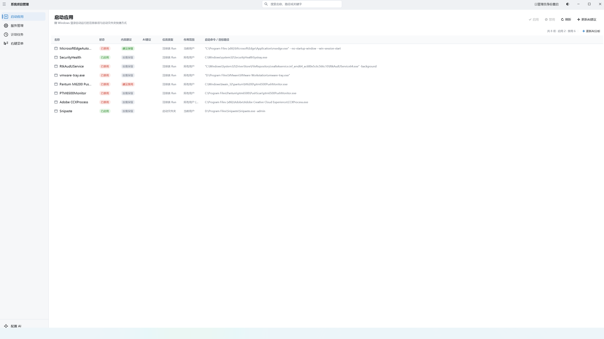
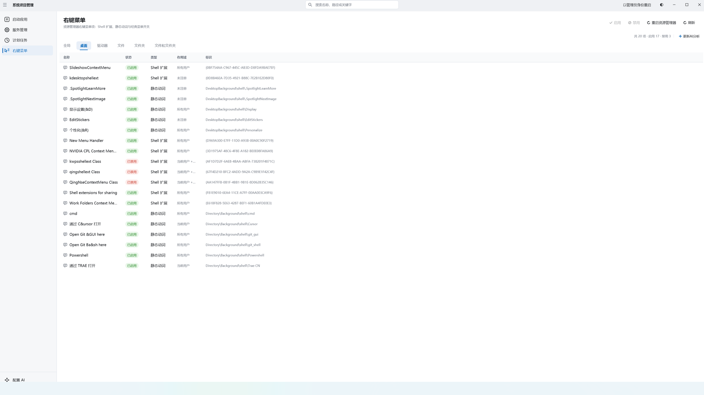
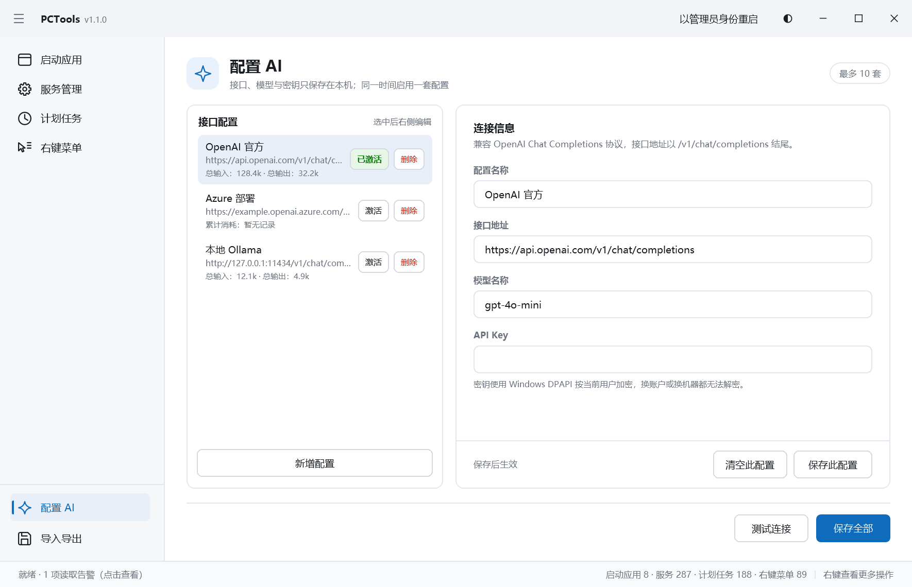

# PCTools

> 一个轻量、免安装的 Windows 系统项目管理工具 —— 集中管理开机启动项、系统服务、计划任务与资源管理器右键菜单，并可借助云端 AI 对每一项给出解释与处理建议。

<p align="center">
  
</p>

<p align="center">
  <a href="#功能特性">功能特性</a> ·
  <a href="#截图预览">截图预览</a> ·
  <a href="#快速开始">快速开始</a> ·
  <a href="#从源码构建">从源码构建</a> ·
  <a href="#隐私与安全">隐私与安全</a>
</p>

---

## 为什么需要 PCTools

Windows 把「开机自动运行的东西」拆散在四处：注册表 `Run` 项、启动文件夹、系统服务、任务计划程序，以及资源管理器的 Shell 扩展与右键动词。要逐一排查「电脑为什么开机慢」「这个进程是什么」「这个右键菜单项是谁装上去的」，通常要在多个系统工具之间来回切换。

PCTools 把这四类项目汇聚到同一个界面，提供三方面的能力：

- **看得清**：统一列出名称、状态、位置、命令/路径，并用红绿标签标记启用状态与内置建议。
- **管得了**：选中即可启用、禁用、启动、停止，无需记忆注册表路径或命令行参数。
- **看得懂**：可选的云端 AI 分析，逐项或批量解释「这是什么、能不能关」，降低误操作风险。

整个程序是**单个 EXE 文件**，无需安装、不写注册表、不驻留后台，双击即用。

## 功能特性

### 四大管理视图

| 视图 | 说明 | 支持的操作 |
| --- | --- | --- |
| **启动应用** | 汇总注册表 Run 项（当前用户 / 所有用户）、启动文件夹、RunOnce 条目 | 启用、禁用、刷新 |
| **服务管理** | 列出所有 Windows 服务，含运行状态、启动类型、服务类型、账户与可执行路径 | 启动、停止、启用、禁用、刷新 |
| **计划任务** | 展示任务计划程序中的任务，含触发器、执行操作、上次运行时间与结果 | 运行、停止、启用、禁用、刷新 |
| **右键菜单** | 管理资源管理器右键菜单项，区分 Shell 扩展 / 静态动词 / 打包扩展，按全局、桌面、驱动器、文件、文件夹等场景分类 | 启用、禁用、重启资源管理器使其生效、刷新 |

### 智能分析

- **内置建议**：基于内置规则库，对每个项目给出「保留 / 按需禁用 / 可安全禁用」等分级建议及理由，完全离线可用。
- **AI 建议 / AI 分析**：可配置符合 OpenAI Chat Completions 协议（`.../v1/chat/completions`）的接口，将项目清单发送给云端模型，获取更有针对性的解释与处理建议。支持：
  - 批量「更新 AI 建议」——一次性将当前列表发给模型，结果缓存到本地数据库；
  - 逐项「AI 分析」——针对单个项目请求完整说明（消耗 Token 较多）；
  - 最多保存 5 套接口配置，随时切换，附带连接测试与 Token 用量统计。

### 使用体验

- **权限自适应**：启动时若未提权，弹窗说明并允许「以普通权限继续」（仅查看）或「以管理员身份重启」（可执行修改）。
- **双主题**：浅色 / 深色一键切换，偏好持久化保存。
- **DPI 感知**：支持 Per-Monitor V2，高分屏与混合 DPI 多显示器下清晰显示。
- **本地搜索**：按名称、路径或关键字实时过滤当前列表。
- **零依赖部署**：仅依赖系统自带的 .NET Framework 4.8 与 WPF 运行时，Windows 10 / 11 开箱即用。

## 截图预览

<details>
<summary><b>启动应用</b> —— 开机自启动项一览，红绿标签标记状态与建议</summary>

<p align="center">
  
</p>

</details>

<details>
<summary><b>服务管理</b> —— 服务状态、启动类型、可执行路径集中查看</summary>

<p align="center">
  
</p>

</details>

<details>
<summary><b>计划任务</b> —— 触发器、执行操作、上次运行结果一目了然</summary>

<p align="center">
  
</p>

</details>

<details>
<summary><b>右键菜单</b> —— 按使用场景分类，识别 Shell 扩展与静态动词</summary>

<p align="center">
  
</p>

</details>

<details>
<summary><b>配置 AI</b> —— 多套接口配置、连接测试与用量统计</summary>

<p align="center">
  
</p>

</details>

## 快速开始

### 1. 下载与运行

从 [Releases](../../releases) 下载最新的 `PCTools.exe`，或直接用源码构建。这是一个免安装程序：

1. 双击 `PCTools.exe` 运行；
2. 首次启动时会出现权限提示：
   - 只想查看列表 → 选择「以普通权限继续」；
   - 需要启用 / 禁用 / 启动 / 停止等操作 → 选择「以管理员身份重启」（会触发系统 UAC 弹窗）。
3. 在左侧导航切换功能视图，使用顶部搜索框过滤条目。

> **说明**：程序主文件名保持为 `PCTools.exe` 即可；配置与缓存数据存放在同目录的 `PCToolsAI.sqlite` 中。

### 2. （可选）启用 AI 分析

内置建议无需任何配置即可使用。若要启用云端 AI 分析：

1. 点击左侧导航「配置 AI」；
2. 点击「新增」，填写：
   - **配置名称**：便于识别，例如 `OpenAI`；
   - **接口地址**：符合 OpenAI Chat Completions 协议的完整地址，例如 `https://api.openai.com/v1/chat/completions`；
   - **API Key**：你的接口密钥；
   - **模型名称**：例如 `gpt-4o-mini`；
3. 点击「测试连接」验证，再点「保存」；
4. 回到任一列表页，点击「更新 AI 建议」进行批量分析，或打开某项的「AI 分析」进行逐项分析。

密钥通过 Windows DPAPI 按当前用户加密后存储于本地数据库，仅当前用户可读取。

## 从源码构建

构建仅依赖系统自带的 .NET Framework 4.8 编译器（无需安装 Visual Studio）。

**环境要求**：Windows 10 / 11，已安装 .NET Framework 4.8（系统自带）。

在项目目录运行：

```bat
build.cmd
```

构建脚本调用框架自带的 `csc.exe`，把 `PCTools.cs` 与 `PCTools.Views.cs` 编译为单文件 `PCTools.exe`，并附带图标与 DPI 感知清单。

```bat
build.cmd diag
```

`diag` 参数会在编译时定义 `DIAG`，包含自检 / 诊断模式代码（发布版默认排除）。

源码结构：

| 文件 | 说明 |
| --- | --- |
| `PCTools.cs` | 核心逻辑：数据模型、系统信息采集、注册表 / 服务 / 任务操作、AI 请求、SQLite 存储等 |
| `PCTools.Views.cs` | 界面层：以 XAML 字符串动态构建的 WPF 窗体、样式与对话框 |
| `PCTools.manifest` | 应用程序清单：DPI 感知、权限级别、兼容声明 |
| `PCTools.ico` | 程序图标 |
| `build.cmd` | 构建脚本 |

## 技术栈

- **语言 / 框架**：C#，WPF（.NET Framework 4.8）
- **编译方式**：系统自带 `csc.exe`，无第三方 NuGet 依赖
- **系统交互**：WMI、注册表、服务控制管理器、任务计划程序、Shell 扩展枚举
- **数据存储**：`winsqlite3.dll`（系统内置），AI 配置与缓存存放于 `PCToolsAI.sqlite`
- **AI 接口**：OpenAI Chat Completions 兼容协议（TLS 1.2+）

## 隐私与安全

- **默认离线**：内置建议完全在本地计算；只有当你**主动配置** AI 接口并点击「更新 AI 建议 / AI 分析」时，才会向云端发送数据。
- **发送内容有限**：AI 功能仅发送项目的名称、命令行 / 可执行文件路径、系统版本等用于判断的必要信息，不会读取或上传你的个人文件。相关说明在 AI 分析确认弹窗中有明确展示。
- **密钥安全**：API Key 使用 Windows DPAPI 按当前用户加密，数据库文件权限也限制为当前用户。
- **权限最小化**：程序清单声明 `asInvoker`，不默认提权；仅在用户主动选择时以管理员身份重启。

## 注意事项

- 修改系统级服务、计划任务，以及所有用户的启动项需要管理员权限；普通权限下仅可查看。
- 禁用启动项 / 服务 / 任务前，请结合内置建议与 AI 分析判断用途，避免禁用系统关键组件。
- 禁用右键菜单项后，点击「重启资源管理器」使其生效（任务栏会闪烁 1–2 秒）。
- AI 分析按请求消耗 Token，逐项分析成本较高，建议优先使用批量「更新 AI 建议」。

---

<p align="center">如果这个项目对你有帮助，欢迎点一个 ⭐。</p>
