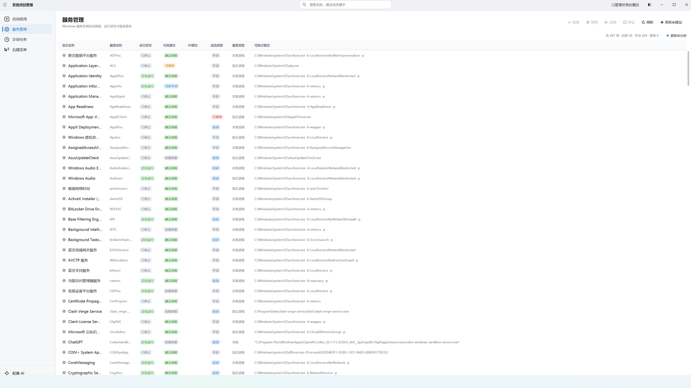
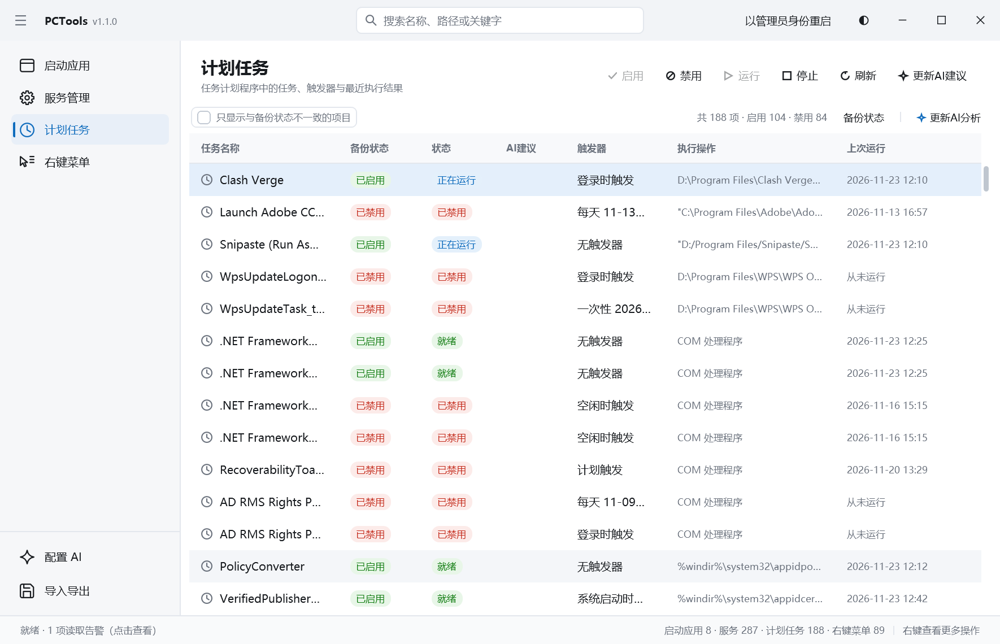
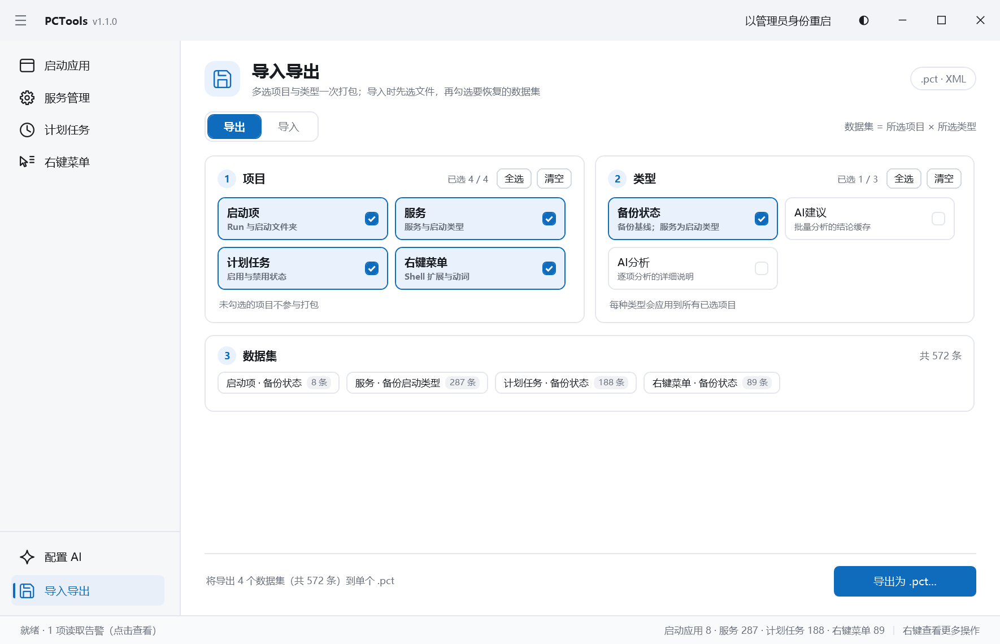
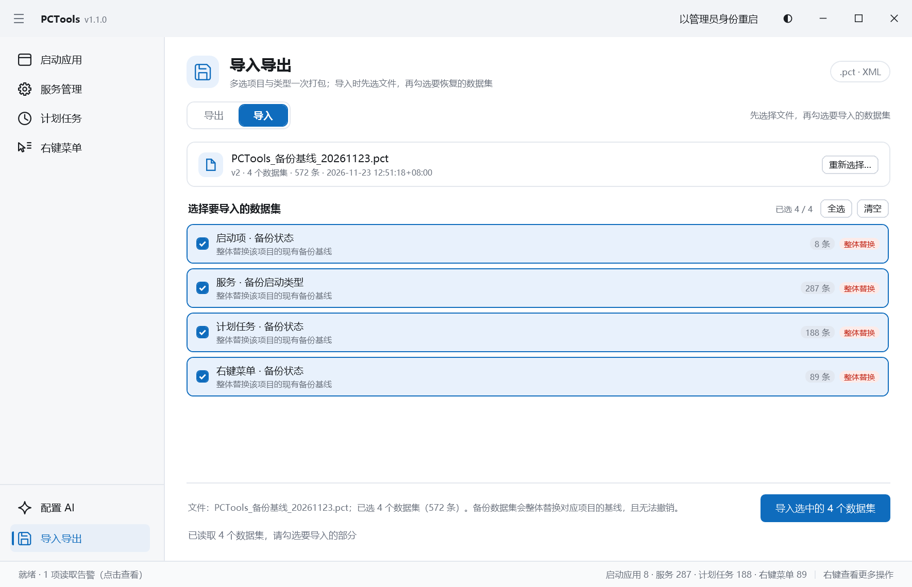
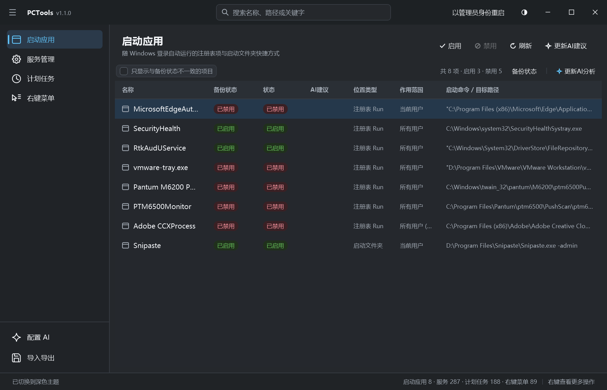

# PCTools

> 一个轻量、免安装的 Windows 系统项目管理工具 —— 集中管理开机启动项、系统服务、计划任务与资源管理器右键菜单，并可借助云端 AI 对每一项给出解释与处理建议。

<p align="center">
  <b>v1.1.1</b> · 单文件免安装 · Windows 10 / 11 · .NET Framework 4.8
</p>

<p align="center">
  
</p>

<p align="center">
  <a href="#功能特性">功能特性</a> ·
  <a href="#截图预览">截图预览</a> ·
  <a href="#快速开始">快速开始</a> ·
  <a href="#从源码构建">从源码构建</a> ·
  <a href="#隐私与安全">隐私与安全</a>
</p>

---

## 为什么需要 PCTools

Windows 把「开机自动运行的东西」拆散在四处：注册表 `Run` 项、启动文件夹、系统服务、任务计划程序，以及资源管理器的 Shell 扩展与右键动词。要逐一排查「电脑为什么开机慢」「这个进程是什么」「这个右键菜单项是谁装上去的」，通常要在多个系统工具之间来回切换。

PCTools 把这四类项目汇聚到同一个界面，提供三方面的能力：

- **看得清**：统一列出名称、状态、位置、命令/路径，并用红绿标签标记启用状态。
- **管得了**：选中即可启用、禁用、启动、停止，无需记忆注册表路径或命令行参数。
- **看得懂**：可选的云端 AI 分析，逐项或批量解释「这是什么、能不能关」，降低误操作风险。

整个程序是**单个 EXE 文件**，无需安装、不写注册表、不驻留后台，双击即用。

## 功能特性

### 四大管理视图

| 视图 | 说明 | 支持的操作 |
| --- | --- | --- |
| **启动应用** | 汇总注册表 Run 项（当前用户 / 所有用户）、启动文件夹、RunOnce 条目 | 启用、禁用、刷新 |
| **服务管理** | 列出所有 Windows 服务，含运行状态、启动类型、服务类型、账户与可执行路径 | 启动、停止、启用、禁用、刷新 |
| **计划任务** | 展示任务计划程序中的任务，含触发器、执行操作、上次运行时间与结果 | 运行、停止、启用、禁用、刷新 |
| **右键菜单** | 管理资源管理器右键菜单项，区分 Shell 扩展 / 静态动词 / 打包扩展，按全局、桌面、驱动器、文件、文件夹等场景分类 | 启用、禁用、重启资源管理器使其生效、刷新 |

### 智能分析

- **AI 建议 / AI 分析**：可配置符合 OpenAI Chat Completions 协议（`.../v1/chat/completions`）的接口，将项目清单发送给云端模型，获取更有针对性的解释与处理建议。支持：
  - 批量「更新 AI 建议」——一次性将当前列表发给模型，结果缓存到本地数据库；
  - 逐项「AI 分析」——针对单个项目请求完整说明（消耗 Token 较多）；
  - 最多保存 10 套接口配置：列表行内直接「激活」切换（当前一套显示绿色「已激活」），行内可删除；「新增配置」固定在列表底部，连接测试与 Token 用量按套独立统计。

### 备份基线与差异追踪

- 四个列表页在状态列前各有一列备份值：启动项、计划任务、右键菜单为「备份状态」，服务为「备份启动类型」。计划任务记录的是启用 / 禁用，不含「正在运行」「就绪」等运行态。
- 备份列按值本身着色（已禁用红、已启用绿、自动蓝、未备份灰），与相邻状态列的视觉语义一致。
- 点击列表右上角的「备份状态 / 备份启动类型」，把当前页**全部**项目的当前值写为对比基线（覆盖旧基线，且不受搜索与筛选影响）。
- 勾选列表左上角的「只显示与备份不一致的项目」，即可只保留发生变化或从未备份的条目；从未备份的项目显示「未备份」，同样计入不一致。
- 每用户服务（如 `AarSvc_55e45`）的下划线后缀是登录会话标识，每次登录都会变；匹配基线时若精确命中不到，会自动回落到服务模板名（`AarSvc`），换会话后不会误显示「未备份」。

### 导入导出

- 「导入导出」页有导出与导入两种模式。
- **导出**：项目与类型均可多选，按「项目 × 类型」生成数据集（最多 4×3=12 个），合并为一个 `.pct` 文件；空数据集自动跳过，全部为空时拒绝导出。导出时显示逐数据集进度，完成后弹窗列出文件位置、每个数据集的条数与跳过的空集。
- **导入**：先选择 `.pct` 文件，页面会列出文件内的数据集（项目 / 类型 / 条数 / 覆盖语义），勾选要恢复的数据集后再执行；页面上的项目/类型勾选不影响导入内容。导入时显示逐数据集进度，完成后弹窗分别列出已导入、未导入的数据集与原因，以及被跳过条目的明细。
- 文件格式：单数据集写 v1（旧版本程序可读），多数据集写 v2；导入同时兼容 v1 与 v2。文件上限 16 MB、总条目 30000（单集 20000），解析时禁用 DTD，重复数据集与未知版本会被拒绝。
- 导入语义：备份基线按项目整体替换；AI 建议按「项目 + 条目」覆盖；AI 分析按条目整组替换，文件中未出现的条目保持不动。

### 使用体验

- **权限自适应**：启动时若未提权，弹窗说明并允许「以普通权限继续」（仅查看）或「以管理员身份重启」（可执行修改）。
- **双主题**：浅色 / 深色一键切换，偏好持久化保存。
- **DPI 感知**：支持 Per-Monitor V2，高分屏与混合 DPI 多显示器下清晰显示。
- **窗口行为**：最大化只占当前显示器的工作区，不遮挡任务栏；标题栏按钮与搜索框始终垂直居中。
- **本地搜索**：按名称、路径或关键字实时过滤当前列表。
- **零依赖部署**：仅依赖系统自带的 .NET Framework 4.8 与 WPF 运行时，Windows 10 / 11 开箱即用。

## 截图预览

<details>
<summary><b>启动应用</b> —— 开机自启动项一览，红绿标签标记状态与备份差异</summary>

<p align="center">
  
</p>

</details>

<details>
<summary><b>服务管理</b> —— 服务状态、启动类型、备份启动类型与可执行路径集中查看</summary>

<p align="center">
  
</p>

</details>

<details>
<summary><b>计划任务</b> —— 触发器、执行操作、上次运行结果一目了然</summary>

<p align="center">
  
</p>

</details>

<details>
<summary><b>右键菜单</b> —— 按使用场景分类，识别 Shell 扩展与静态动词</summary>

<p align="center">
  
</p>

</details>

<details>
<summary><b>配置 AI</b> —— 多套接口配置，行内激活切换，用量按套独立统计</summary>

<p align="center">
  
</p>

</details>

<details>
<summary><b>导入导出 · 导出</b> —— 按「项目 × 类型」打包为单个 <code>.pct</code> 文件，空数据集自动跳过</summary>

<p align="center">
  
</p>

</details>

<details>
<summary><b>导入导出 · 导入</b> —— 先选择文件，再按数据集勾选要恢复的内容</summary>

<p align="center">
  
</p>

</details>

<details>
<summary><b>深色主题</b> —— 一键切换，列表、卡片与对话框同步换色</summary>

<p align="center">
  
</p>

</details>

## 快速开始

### 1. 下载与运行

从 [Releases](../../releases) 下载最新的 `PCTools.exe`，或直接用源码构建。这是一个免安装程序：

1. 双击 `PCTools.exe` 运行；
2. 首次启动时会出现权限提示：
   - 只想查看列表 → 选择「以普通权限继续」；
   - 需要启用 / 禁用 / 启动 / 停止等操作 → 选择「以管理员身份重启」（会触发系统 UAC 弹窗）。
3. 在左侧导航切换功能视图，使用顶部搜索框过滤条目；底部的「配置 AI」「导入导出」会在内容区打开独立设置页，点击左侧任意列表项即可返回。

> **说明**：程序主文件名保持为 `PCTools.exe` 即可；配置与缓存数据存放在同目录的 `PCToolsAI.sqlite` 中。

### 2. （可选）启用 AI 分析

若要启用云端 AI 分析：

1. 点击左侧导航「配置 AI」进入配置页；
2. 点击列表底部的「新增配置」，填写：
   - **配置名称**：便于识别，例如 `OpenAI`；
   - **接口地址**：符合 OpenAI Chat Completions 协议的完整地址，例如 `https://api.openai.com/v1/chat/completions`；
   - **API Key**：你的接口密钥；
   - **模型名称**：例如 `gpt-4o-mini`；
3. 点击「测试连接」验证，再点「保存此配置」；有多套配置时，点列表行内的「激活」切换当前启用的一套（当前一套显示绿色「已激活」），最后点「保存全部」写入；
4. 想重填可点「清空此配置」，只清空表单，保存后才会写库；
5. 回到任一列表页，点击「更新 AI 建议」进行批量分析，或打开某项的「AI 分析」进行逐项分析。

密钥通过 Windows DPAPI 按当前用户加密后存储于本地数据库，仅当前用户可读取。

## 从源码构建

构建仅依赖系统自带的 .NET Framework 4.8 编译器（无需安装 Visual Studio）。

**环境要求**：Windows 10 / 11，已安装 .NET Framework 4.8（系统自带）。

在项目目录运行：

```bat
build.cmd
```

构建脚本调用框架自带的 `csc.exe`，把 13 个 `.cs` 源文件编译为单文件 `PCTools.exe`，并附带图标与 DPI 感知清单。发布版仍会编译 `PCTools.Diag.cs`，但其中代码整体包在 `#if DIAG` 内，不会进入发布产物。

```bat
build.cmd diag
```

`diag` 参数会在编译时定义 `DIAG`，包含自检 / 诊断模式代码，输出到 `%TEMP%\PCToolsDiag\PCToolsDiag.exe`。项目目录始终只保留发布版 `PCTools.exe`，不会再生成第二个 exe；自检代码也不会进入发布产物。

需要重新生成文档截图时，运行 `--shots`：它会切到临时数据库并写入一套演示数据（三套 AI 配置、四页备份基线），把 8 张截图输出到 `%TEMP%`，不会读写你的真实 `PCToolsAI.sqlite`：

```bat
%TEMP%\PCToolsDiag\PCToolsDiag.exe --shots
```

源码结构：

| 文件 | 说明 |
| --- | --- |
| `PCTools.cs` | 程序头与数据模型：四类系统项目的视图模型、批量计划对象、程序集信息与版本常量 |
| `PCTools.Storage.cs` | 存储层：诊断日志、数据目录选择、SQLite 封装、配置 / 建议 / 分析 / 用量表 |
| `PCTools.System.cs` | 系统层：右键菜单注册表、启动项 / 服务 / 计划任务 / 右键菜单的枚举与操作 |
| `PCTools.Ai.cs` | AI 层：Key 加密、接口配置、HTTP 客户端、JSON 解析与批量提示词 |
| `PCTools.Backup.cs` | 备份基线：四页覆盖式读写、基线回填与「只看不一致」筛选 |
| `PCTools.Transfer.cs` | 导入导出：`.pct` 数据包读写、三类数据的 SQL 导入导出与页面 |
| `PCTools.Theme.cs` | 主题：浅色 / 深色资源字典构建与偏好读写 |
| `PCTools.Settings.cs` | 设置页：可复用的「配置 AI」视图与主窗口设置页切换 |
| `PCTools.MainWindow.cs` | 主窗口：四页列表、筛选排序、批量操作、备份栏与 AI 入口 |
| `PCTools.Dialogs.cs` | 对话框：进度、确认、提示、AI 结果窗，以及弹窗主题外壳 |
| `PCTools.Program.cs` | 程序入口：单实例、提权、异常兜底与启动流程 |
| `PCTools.Views.cs` | 界面层：以 XAML 字符串动态构建的 WPF 窗体、样式与对话框 |
| `PCTools.Diag.cs` | 自检 / 诊断模式实现（仅 `build.cmd diag` 编译，输出到 `%TEMP%\PCToolsDiag`，发布版不进 exe） |
| `PCTools.manifest` | 应用程序清单：DPI 感知、权限级别、兼容声明（仅 Windows 10 / 11） |
| `PCTools.ico` | 程序图标 |
| `build.cmd` | 构建脚本 |

## 技术栈

- **语言 / 框架**：C#，WPF（.NET Framework 4.8）
- **编译方式**：系统自带 `csc.exe`，无第三方 NuGet 依赖
- **系统交互**：WMI、注册表、服务控制管理器、任务计划程序、Shell 扩展枚举
- **数据存储**：`winsqlite3.dll`（系统内置），AI 配置与缓存存放于 `PCToolsAI.sqlite`
- **AI 接口**：OpenAI Chat Completions 兼容协议（TLS 1.2+）

## 隐私与安全

- **默认离线**：只有当你**主动配置** AI 接口并点击「更新 AI 建议 / AI 分析」时，才会向云端发送数据。
- **发送内容有限**：AI 功能仅发送项目的名称、命令行 / 可执行文件路径、系统版本等用于判断的必要信息，不会读取或上传你的个人文件。相关说明在 AI 分析确认弹窗中有明确展示。
- **密钥安全**：API Key 使用 Windows DPAPI 按当前用户加密，数据库文件权限也限制为当前用户。
- **权限最小化**：程序清单声明 `asInvoker`，不默认提权；仅在用户主动选择时以管理员身份重启。

## 注意事项

- 修改系统级服务、计划任务，以及所有用户的启动项需要管理员权限；普通权限下仅可查看。
- 禁用启动项 / 服务 / 任务前，请结合 AI 分析判断用途，避免禁用系统关键组件。
- 禁用右键菜单项后，点击「重启资源管理器」使其生效（任务栏会闪烁 1–2 秒）。
- AI 分析按请求消耗 Token，逐项分析成本较高，建议优先使用批量「更新 AI 建议」。
- 配置 AI 页的「激活」只切换当前启用项（尚未写库），需再点「保存全部」才会持久化；「保存此配置」只保存当前这一套。
- 「备份状态 / 备份启动类型」是覆盖式基线，再次备份会整体替换旧值；需要保留历史时，请先用「导入导出」保存为 `.pct`。
- 从 10 套接口配置回退到旧版本前，请先在当前版本把配置删到 5 套：旧版本的保存是整表重写，会清掉第 6–10 套。
- **不要把便携版放在任何人都可写的目录**（如 `C:\Users\Public`、共享盘）：任何能替换 `PCTools.exe` 的账户，都能在你下次以管理员身份运行时获得提权执行。建议放在个人目录或 `Program Files` 下由管理员安装。
- 同一台电脑有多个 Windows 账户时，配置库按账户隔离：首次运行会把库权限收窄到当前用户；其他账户无法读取时会自动在各自的 `%LOCALAPPDATA%\PCTools` 下新建独立库，界面会提示一次。

## v1.1.1 修复摘要

- **不再删库升级**：v1.0 的库没有版本号但结构一致，现改为补齐表结构后直接沿用；确需重建时先改名为 `.bak-<时间戳>` 并告知路径。
- 备份基线读取失败不再被当成「全部未备份」；启动项 AI 键区分当前用户/所有用户；打包扩展改用包族名，应用升级后不再失配。
- 取消 AI 任务后即使强制关闭进度窗，也不会提前释放忙碌标记，避免两个 worker 并发写库。
- 单条 AI 分析增加 150 秒总预算与「取消」入口；导入/导出支持「完成当前数据集后停止」并显示已用时长。
- 导入/导出补齐 XML 非法字符与代理项处理；读取告警保留真实条数；映射网络驱动器上的数据库自动回退到本机。
- 进度窗/分析窗/传输页的状态色随主题刷新；确认框 Esc 等于取消；隐私同意指纹改用 SHA-256。

---

<p align="center">如果这个项目对你有帮助，欢迎点一个 ⭐。</p>
